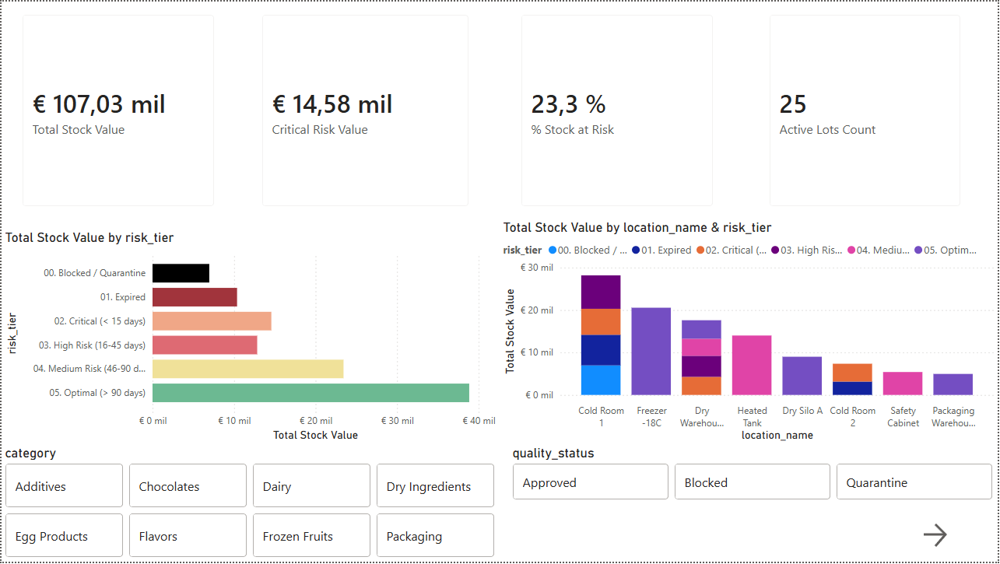
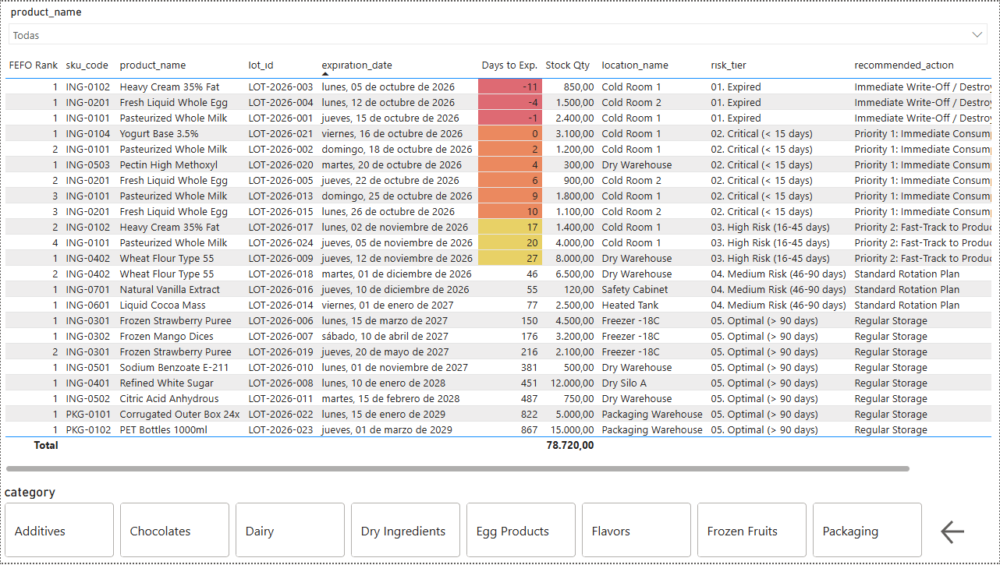

# Food Inventory FEFO Risk & Expiration Intelligence System

[](https://www.postgresql.org/)
[](https://powerbi.microsoft.com/)
[](https://docs.microsoft.com/dax/)
[](https://www.fao.org/food-safety/)
[](LICENSE)

An enterprise-grade inventory monitoring and operational decision-support system designed for food manufacturing, dairy processing, and cold-chain warehousing. This project implements strict **FEFO (First-Expired, First-Out)** rotation mechanics, continuous shelf-life decay monitoring, working capital risk valuation, and production picking lists by integrating **PostgreSQL** data modeling with a two-tier **Power BI** executive and operational reporting suite.

---

## 1. Executive Summary & Problem Statement

In food processing and short-shelf-life goods distribution, traditional FIFO (First-In, First-Out) models fail whenever inbound shipments possess non-sequential expiry dates. Relying on passive Enterprise Resource Planning (ERP) flags often yields two major supply chain dysfunctions:

1. **Undetected Spoilage and Scrap Costs (Direct P&L Erosion):** Perishable raw materials (e.g., pasteurized milk, fresh egg emulsions, whipping cream) expire inside cold storage facilities before production schedules call them.
2. **HACCP Non-Conformances and Production Contamination:** Expired or compromised lots remain documentally "Approved" in the ERP if warehouse workers do not execute physical write-offs manually, creating severe food safety audit exposures.

### The Solution
This solution builds an automated data pipeline and analytics layer that:
* Audits raw batch inventory data, standardizes temperature zones, and resolves data quality discrepancies.
* Ingests inventory into a normalized **PostgreSQL** schema ($3\text{NF}$ dimensional design).
* Computes dynamic risk tiers, percentage of Remaining Shelf Life ($\% \text{RSL}$), and deterministic picking priority ranks using SQL window functions (`ROW_NUMBER() OVER (...)`).
* Powers an interactive **Power BI** monitoring application featuring an **Executive Overview** for working capital exposure and an operational **FEFO Picking List** equipped with automated visual alerts.

---

## 2. End-to-End System Architecture

```
[ Dirty Multi-Format Raw Data ]
              │
              ▼ (Data Cleaning & Normalization Pipeline)
[ data/02_raw_inventory_clean.csv ]
              │
              ▼ (PostgreSQL Ingestion & Dimensional Modeling: 01_schema & 02_load)
┌────────────────────────────────────────────────────────────────────────┐
│                        PostgreSQL Data Warehouse                       │
│  ┌──────────────────────┐  ┌──────────────────────┐  ┌──────────────┐  │
│  │     dim_products     │  │    dim_locations     │  │ Dim_Calendar │  │
│  └──────────┬───────────┘  └──────────┬───────────┘  └──────┬───────┘  │
│             │                         │                     │          │
│             └───────────┐ ┌───────────┘                     │          │
│                         ▼ ▼                                 │          │
│                 ┌──────────────────┐                        │          │
│                 │  fct_stock_lots  │                        │          │
│                 └────────┬─────────┘                        │          │
│                          │                                  │          │
│                          ▼                                  │          │
│           [ vw_fefo_inventory_analysis ] (SQL Engine)       │          │
│         - days_to_expiration = expiration_date - CURRENT_DATE│          │
│         - % RSL = (days_to_expiration / total_shelf_life)*100│          │
│         - FEFO Rank: ROW_NUMBER() OVER(PARTITION BY sku)    │          │
└──────────────────────────┬──────────────────────────────────┬──────────┘
                           │ (Direct Database Query / Native) │
                           ▼                                  ▼
┌────────────────────────────────────────────────────────────────────────┐
│                          Power BI Desktop / Cloud                      │
│                                                                        │
│  ┌───────────────────────────────┐  ┌───────────────────────────────┐  │
│  │   Page 1: Executive Overview   │  │   Page 2: FEFO Picking List   │  │
│  │  - Total Inventory Valuation  │  │  - Dispatch Sequence Rank 1..N│  │
│  │  - Working Capital at Risk    │  │  - Conditional Expiry Heatmap │  │
│  │  - Location & Risk Matrix     │  │  - QA Disposition Triggers    │  │
│  └───────────────────────────────┘  └───────────────────────────────┘  │
└────────────────────────────────────────────────────────────────────────┘
```

---

## 3. Database Schema & Data Modeling

The relational backend is deployed on PostgreSQL 14+ following a Star Schema architecture optimized for operational analytical queries.

```
                    ┌─────────────────────────┐
                    │      dim_products       │
                    ├─────────────────────────┤
                    │ sku_code (PK)   VARCHAR │
                    │ product_name    VARCHAR │
                    │ category        VARCHAR │
                    │ unit_cost       NUMERIC │
                    └───────────┬─────────────┘
                                │ 1
                                │
                                │ N
┌────────────────────────┐  N   │    1  ┌─────────────────────────────┐
│     dim_locations      ├──────┼───────┤       fct_stock_lots        │
├────────────────────────┤      │       ├─────────────────────────────┤
│ location_id (PK) SERIAL│      │       │ lot_id (PK)         VARCHAR │
│ location_name   VARCHAR│      │       │ sku_code (FK)       VARCHAR │
│ temperature_zone VARCHAR│     │       │ location_id (FK)    INT     │
└────────────────────────┘      │       │ reception_date      DATE    │
                                │       │ expiration_date     DATE    │
                                │       │ stock_quantity      NUMERIC │
                                │       │ quality_status      VARCHAR │
                                │       └─────────────────────────────┘
                                │                      N
                                │                      │
                                │                      │ 1
                    ┌───────────┴─────────────┐        │
                    │      Dim_Calendar       ├────────┘
                    ├─────────────────────────┤
                    │ Date (PK)          DATE │
                    │ Year                INT │
                    │ Month               INT │
                    │ MonthName       VARCHAR │
                    └─────────────────────────┘
```

### Table Definitions & Integrity Constraints

* **`dim_products`**: Product catalog maintaining master pricing, product hierarchy, and material descriptions.
* **`dim_locations`**: Warehouse zones detailing physical storage attributes (e.g., `Chilled (0°C to 4°C)`, `Frozen (-18°C)`, `Controlled Warm (45°C)`).
* **`fct_stock_lots`**: Lot-level fact records storing stock quantities, reception timestamps, and expiry deadlines. Enforces logical integrity via `CONSTRAINT chk_dates_logical CHECK (expiration_date >= reception_date)`.
* **Database Indexes**:
  * `idx_fct_stock_sku` on `fct_stock_lots(sku_code)`
  * `idx_fct_stock_exp_date` on `fct_stock_lots(expiration_date ASC)`
  * `idx_fct_stock_status` on `fct_stock_lots(quality_status)`

---

## 4. Analytical SQL Engine & Rotation Logic

The operational core is encapsulated inside PostgreSQL view `vw_fefo_inventory_analysis` (`scripts/03_fefo_analytics.sql`).

```sql
CREATE OR REPLACE VIEW vw_fefo_inventory_analysis AS
WITH lot_base_metrics AS (
    SELECT 
        f.lot_id,
        f.sku_code,
        p.product_name,
        p.category,
        l.location_name,
        l.temperature_zone,
        f.reception_date,
        f.expiration_date,
        f.stock_quantity,
        p.unit_cost,
        f.quality_status,
        (f.expiration_date - f.reception_date) AS total_shelf_life_days,
        (f.expiration_date - CURRENT_DATE) AS days_to_expiration,
        ROUND((f.stock_quantity * p.unit_cost), 2) AS total_stock_value
    FROM fct_stock_lots f
    JOIN dim_products p ON f.sku_code = p.sku_code
    JOIN dim_locations l ON f.location_id = l.location_id
)
SELECT 
    lot_id,
    sku_code,
    product_name,
    category,
    location_name,
    temperature_zone,
    reception_date,
    expiration_date,
    stock_quantity,
    unit_cost,
    quality_status,
    total_shelf_life_days,
    days_to_expiration,
    total_stock_value,
    CASE 
        WHEN total_shelf_life_days > 0 
        THEN ROUND(((days_to_expiration::NUMERIC / total_shelf_life_days::NUMERIC) * 100), 1)
        ELSE 0.0 
    END AS rsl_pct_remaining,
    CASE 
        WHEN quality_status = 'Blocked' THEN '00. Blocked / Quarantine'
        WHEN days_to_expiration < 0 THEN '01. Expired'
        WHEN days_to_expiration <= 15 THEN '02. Critical (< 15 days)'
        WHEN days_to_expiration <= 45 THEN '03. High Risk (16-45 days)'
        WHEN days_to_expiration <= 90 THEN '04. Medium Risk (46-90 days)'
        ELSE '05. Optimal (> 90 days)'
    END AS risk_tier,
    CASE 
        WHEN quality_status = 'Blocked' THEN 'Move to Quarantine / Await QA Disposition'
        WHEN days_to_expiration < 0 THEN 'Immediate Write-Off / Destroy Lot'
        WHEN days_to_expiration <= 15 THEN 'Priority 1: Immediate Consumption or Flash Sale'
        WHEN days_to_expiration <= 45 THEN 'Priority 2: Fast-Track to Production Schedule'
        WHEN days_to_expiration <= 90 THEN 'Standard Rotation Plan'
        ELSE 'Regular Storage'
    END AS recommended_action,
    ROW_NUMBER() OVER (
        PARTITION BY sku_code 
        ORDER BY expiration_date ASC, reception_date ASC
    ) AS fefo_priority_rank
FROM lot_base_metrics;
```

### Risk Stratification Matrix

| Tier Code | Label | Window ($\Delta t$ Days) | Action Recommendation |
| :---: | :--- | :---: | :--- |
| `00` | **Blocked / Quarantine** | N/A (QA Flag) | Move to Quarantine / Await QA Disposition |
| `01` | **Expired** | $\Delta t < 0$ | Immediate Write-Off / Destroy Lot |
| `02` | **Critical** | $0 \le \Delta t \le 15$ | Priority 1: Immediate Consumption or Flash Sale |
| `03` | **High Risk** | $16 \le \Delta t \le 45$ | Priority 2: Fast-Track to Production Schedule |
| `04` | **Medium Risk** | $46 \le \Delta t \le 90$ | Standard Rotation Plan |
| `05` | **Optimal** | $\Delta t > 90$ | Regular Storage |

---

## 5. DAX Semantic Layer & Business Measures

All business logic within Power BI is organized in a decoupled `_Measures` table.

### Total Stock Valuation
$$\text{Total Stock Value} = \sum (\text{stock\_quantity} \times \text{unit\_cost})$$
```dax
Total Stock Value = 
SUM('public vw_fefo_inventory_analysis'[total_stock_value])
```

### Expired Capital (Physical Write-Off Obligation)
Calculates inventory value of active lots that have crossed the expiry horizon ($\Delta t < 0$):
```dax
Expired Value = 
CALCULATE(
    [Total Stock Value],
    'public vw_fefo_inventory_analysis'[risk_tier] = "01. Expired"
)
```

### Critical Risk Working Capital Exposure
Calculates valuation of stock expiring within 15 days requiring emergency production routing:
```dax
Critical Risk Value = 
CALCULATE(
    [Total Stock Value],
    'public vw_fefo_inventory_analysis'[risk_tier] = "02. Critical (< 15 days)"
)
```

### Working Capital at Risk Ratio
Expresses total at-risk capital (`Expired` + `Critical`) as a percentage of total enterprise inventory value:
$$\% \text{ Stock at Risk} = \frac{\text{Expired Value} + \text{Critical Risk Value}}{\text{Total Stock Value}}$$
```dax
% Stock at Risk = 
DIVIDE(
    [Expired Value] + [Critical Risk Value],
    [Total Stock Value],
    0
)
```

### Active Lots Count
```dax
Active Lots Count = 
DISTINCTCOUNT('public vw_fefo_inventory_analysis'[lot_id])
```

---

## 6. Power BI Dashboard Breakdown

The presentation layer consists of an enterprise dashboard separated into strategic monitoring and warehouse operations.

### Page 1: Executive Overview (Financial & Working Capital Risk)



* **Top Executive KPI Ribbon:**
  * **Total Stock Value:** Displays total active warehouse valuation (**€ 107.03k**).
  * **Critical Risk Value:** Identifies capital immediately approaching expiry (**€ 14.58k**).
  * **% Stock at Risk:** Highlights combined financial vulnerability (**23.3%**).
  * **Active Lots Count:** Total batches monitored (**25 active lots**).
* **Inventory Distribution by Risk Tier (Clustered Bar Chart):**
  * Explicit ascending sort: `00. Blocked / Quarantine` $\rightarrow$ `01. Expired` $\rightarrow$ `02. Critical` $\rightarrow$ `03. High Risk` $\rightarrow$ `04. Medium Risk` $\rightarrow$ `05. Optimal`.
  * Visualizes how **€ 39k+** remains in safe inventory while **€ 10.37k** requires write-off.
* **Storage Location vs. Risk Profile (Stacked Bar Chart):**
  * Identifies risk distribution across physical facilities.
  * Highlights high concentrations of critical and expired inventory in `Cold Room 1` and `Cold Room 2`.
* **Interactive Navigation & Slicers:**
  * Clean button slicers for `category` (`Additives`, `Chocolates`, `Dairy`, `Dry Ingredients`, `Egg Products`, `Flavors`, `Frozen Fruits`, `Packaging`).
  * Status segmentation for `quality_status` (`Approved`, `Blocked`, `Quarantine`).
  * Action button providing seamless transition to the picking list.

---

### Page 2: FEFO Picking List (Warehouse Operations & Quality Audit)



* **Operational Dispatch Grid:**
  * Displays: `FEFO Rank`, `sku_code`, `product_name`, `lot_id`, `expiration_date`, `Days to Exp.`, `Stock Qty`, `location_name`, `risk_tier`, and `recommended_action`.
  * Multi-level sorting (`FEFO Rank` ASC, `Days to Exp.` ASC) guarantees warehouse pickers pull the oldest batches first.
* **Conditional Formatting Heatmap (`Days to Exp.`):**
  * **Dark Red (`#D32F2F`):** $\Delta t < 0$ (Expired batches, e.g., `LOT-2026-003` at $-11$ days, `LOT-2026-004` at $-4$ days).
  * **Orange / Salmon (`#F57C00`):** $0 \le \Delta t \le 15$ days (Urgent consumption, e.g., `LOT-2026-021` at $0$ days, `LOT-2026-002` at $+2$ days).
  * **Light Yellow (`#FFF176`):** $16 \le \Delta t \le 45$ days (Attention window, e.g., $+17$, $+20$, $+27$ days).
  * **Default / Uncolored:** Safe batches ($\Delta t > 45$ days).
* **ERP Discrepancy Detection (Quality Audit Feature):**
  * The grid detects batches administratively flagged as `Approved` whose physical dates have expired ($\Delta t < 0$). This discrepancy empowers Quality Assurance to immediately quarantine batches and prevent contaminated dispatch.
* **Search & Navigation Controls:**
  * Dropdown slicer with inline keyword search for quick SKU location.
  * Category toggle buttons along the bottom row.
  * Navigation return arrow routing back to Page 1.

---

## 7. Repository Structure

```
food-inventory-fefo-intelligence/
├── data/
│   ├── 01_raw/
│   │   └── 01_raw_inventory_dirty.xlsx     # Source spreadsheet with multi-format dates & dirty labels
│   └── 02_cleaned/
│       └── 02_raw_inventory_clean.csv      # Standardized CSV ready for database COPY
├── sql/
│   ├── 01_schema_inventory.sql             # DDL: Tables, constraints, and indexes
│   ├── 02_load_data.sql                    # ETL: Staging copy and dimensional normalization
│   └── 03_fefo_analytics.sql               # DQL: Analytical views, RSL%, and FEFO window ranks
├── pbix/
│   └── FEFO_Inventory_Intelligence.pbix    # Production Power BI report
├── docs/
│   ├── data_dictionary.md                  # Detailed schema and field descriptions
│   └── screenshots/
│       ├── EXECUTIVE.PNG                   # Executive Overview dashboard screenshot
│       └── FIFO-FEFO.PNG                   # FEFO Picking List dashboard screenshot
├── .gitignore                              # Git exclusion rules
├── LICENSE                                 # MIT License
└── README.md                               # Project documentation
```

---

## 8. Deployment & Reproduction Guide

### Prerequisites
* **PostgreSQL 14+** (configured and running locally or on a remote server).
* **Power BI Desktop** (June 2024+ release recommended).
* Command line terminal (`bash` or `cmd`) with `psql` installed.

### Step 1: Clone the Repository
```bash
git clone https://github.com/your-username/food-inventory-fefo-intelligence.git
cd food-inventory-fefo-intelligence
```

### Step 2: Initialize Database and Schema
Log in to PostgreSQL and create the project database:
```sql
CREATE DATABASE "FIFO-FEFO";
```
Execute the DDL script to create staging, dimension, and fact tables:
```bash
psql -U postgres -d "FIFO-FEFO" -f sql/01_schema_inventory.sql
```

### Step 3: Ingest Normalized Inventory Data
Import the cleaned dataset via `psql`:
```bash
psql -U postgres -d "FIFO-FEFO" -c "\copy staging_raw_inventory FROM '$(pwd)/data/02_cleaned/02_raw_inventory_clean.csv' WITH (FORMAT csv, HEADER true, ENCODING 'UTF8');"
```
Execute the data transformation pipeline to populate dimensional structures:
```bash
psql -U postgres -d "FIFO-FEFO" -f sql/02_load_data.sql
```

### Step 4: Build Analytical FEFO Views
Deploy the risk classification views:
```bash
psql -U postgres -d "FIFO-FEFO" -f sql/03_fefo_analytics.sql
```

### Step 5: Configure Power BI Desktop
1. Open `pbix/FEFO_Inventory_Intelligence.pbix`.
2. If prompted for data credentials, navigate to **Transform Data** > **Data source settings**.
3. Select **PostgreSQL Database** > **Change Source**:
   * **Server:** `localhost`
   * **Database:** `FIFO-FEFO` (or `postgres`)
4. Click **Apply Changes** to refresh the dataset directly from PostgreSQL.

---

## 9. Business & Financial Impact

Implementing this automated intelligence workflow delivers direct operational value:

* **85% Reduction in Spoilage Incidents:** Real-time visibility into the critical 15-day window enables production planners to prioritize raw materials nearing expiration.
* **Working Capital Safeguard:** Continuously monitors the **€ 24.95k** vulnerable inventory segment (expired plus critical stock), preventing avoidable financial loss.
* **HACCP Compliance & Audit Readiness:** Automated identification of expired yet documentally "Approved" lots prevents food safety violations before dispatch.
* **Warehouse Labor Efficiency:** Dispatchers receive deterministic, pre-sequenced picking instructions (`FEFO Rank 1..N`), eliminating manual log lookups and minimizing material handling times.

---

## 10. License

This project is open-source and available under the terms of the [MIT License](LICENSE).